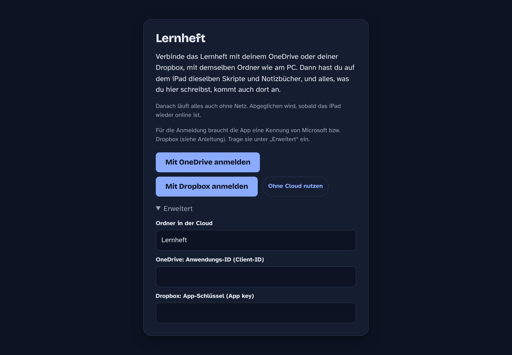
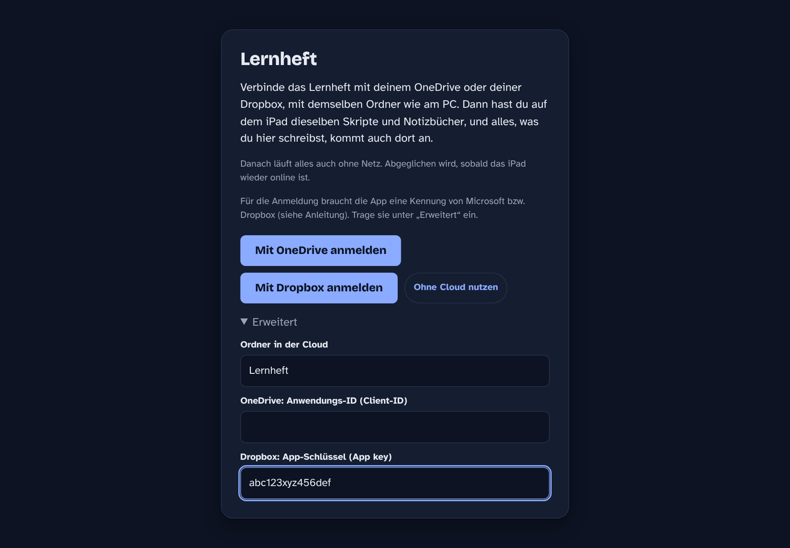
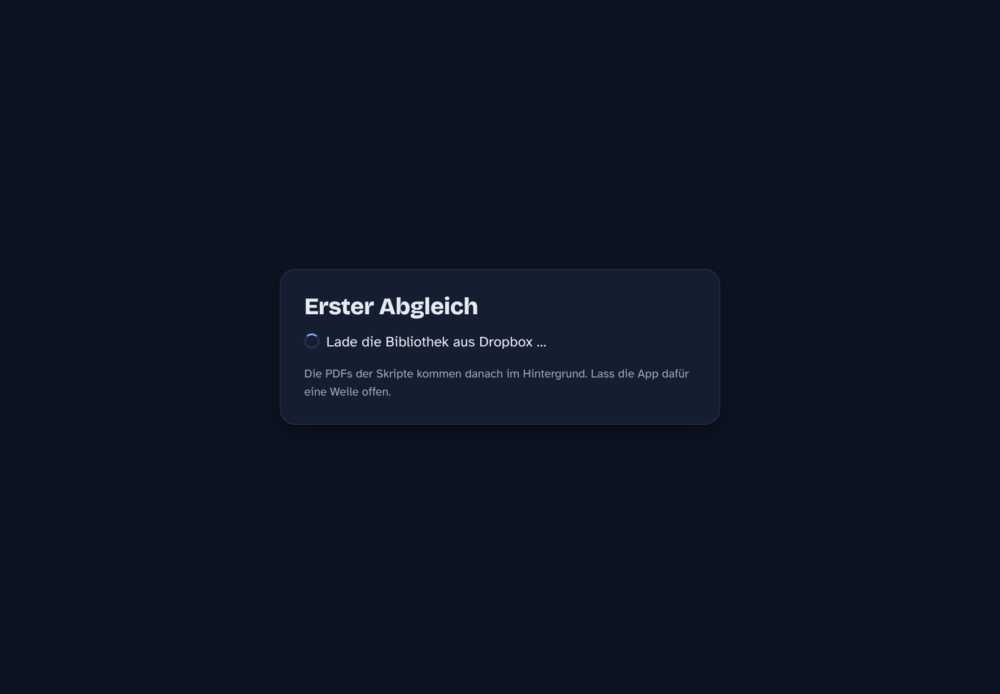
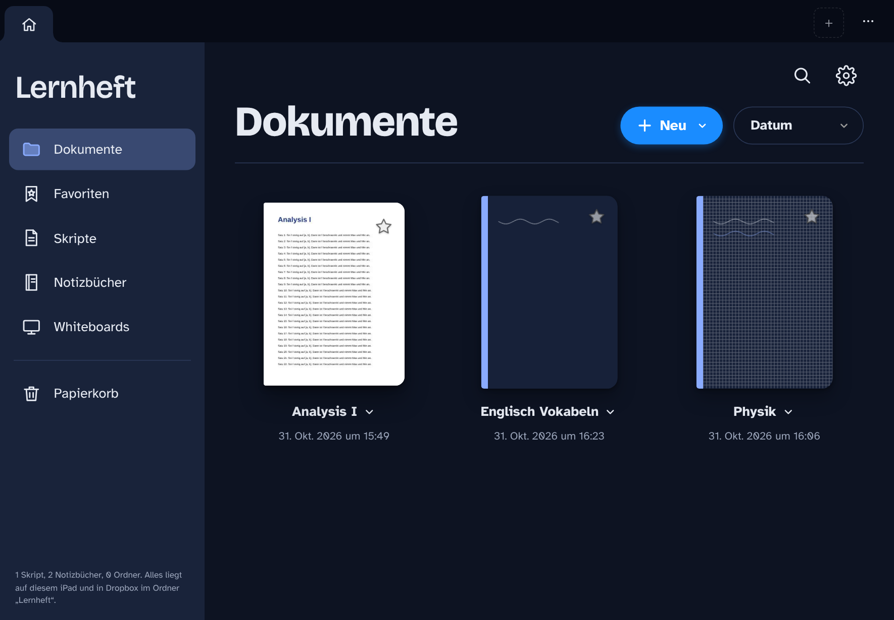
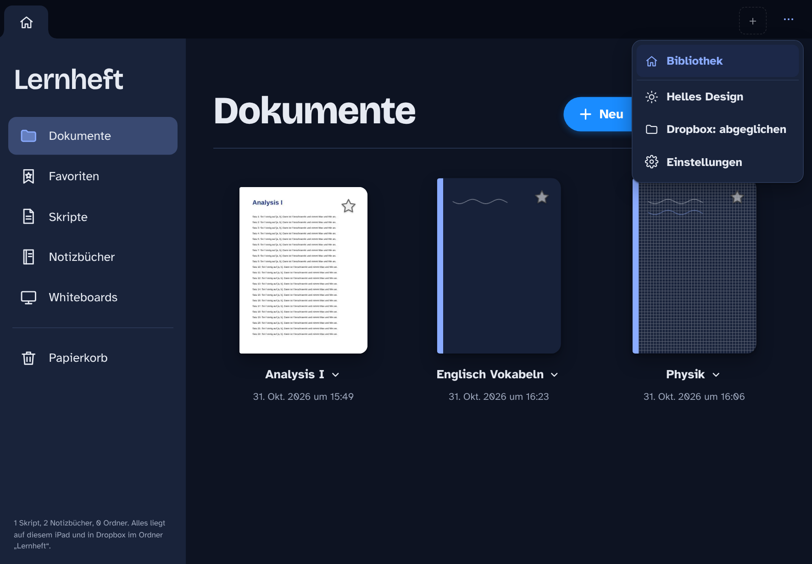
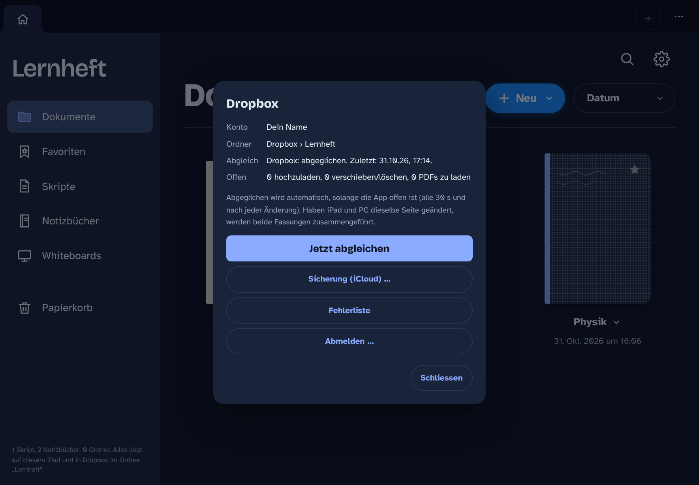
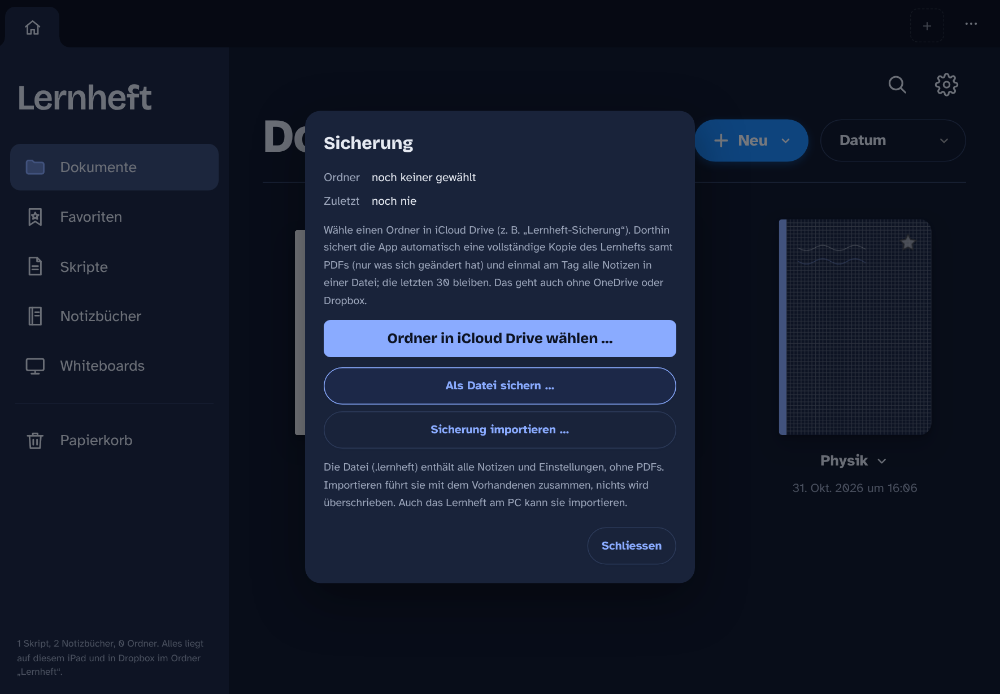
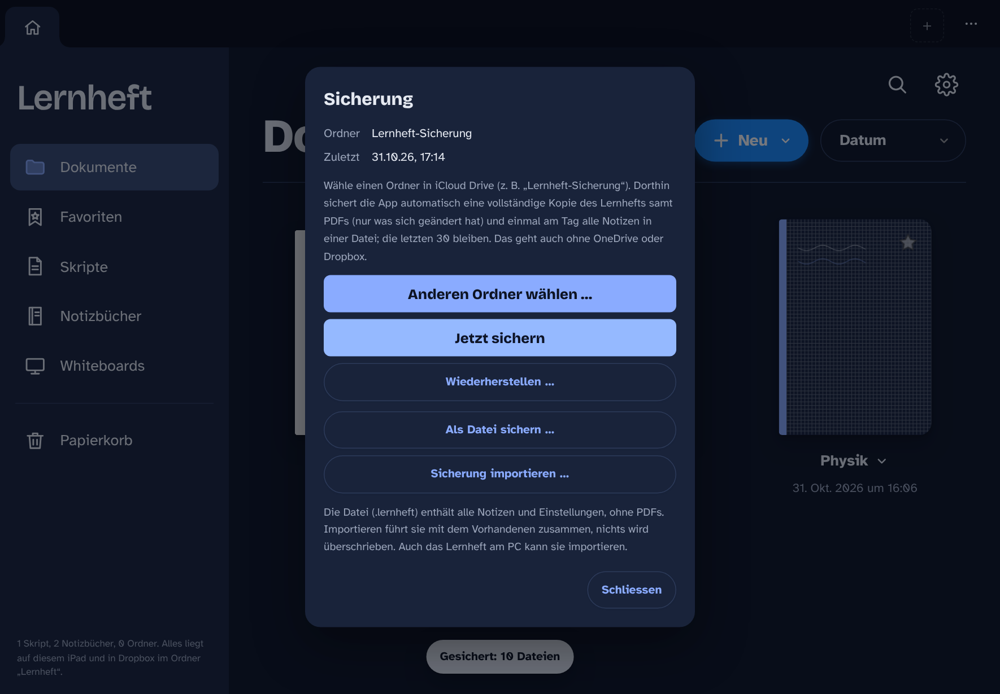
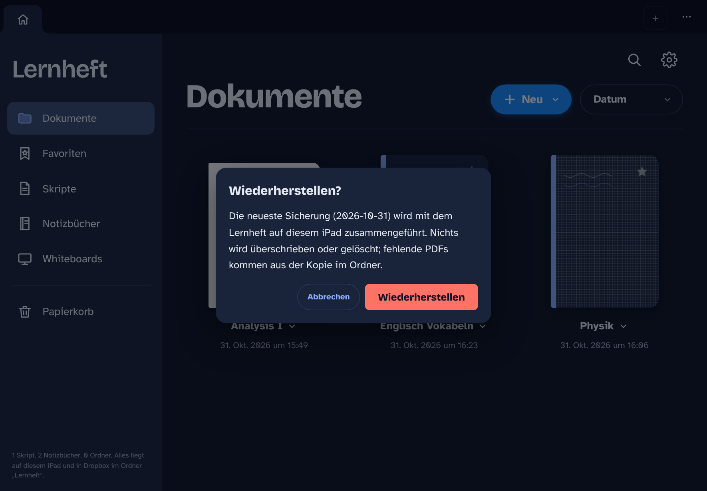

# Lernheft auf dem iPad einstellen (ab Version 3.7)

So richtest du die iPad-App ein: Abgleich mit dem PC über **Dropbox** oder **OneDrive** und dazu eine
**Sicherung in iCloud Drive**. Die Bilder stammen aus der Testversion am PC (iPad quer); auf deinem iPad sieht es
genauso aus.

Wie die App überhaupt aufs iPad kommt (Mac mit Xcode, einmalig), steht in
[`Programm/Quellcode/ipad/ANLEITUNG.md`](../Programm/Quellcode/ipad/ANLEITUNG.md), Schritte 2 und 3.

---

## Überblick: was wohin gehört

| Was | Wo | Wozu |
| --- | --- | --- |
| Lernheft-Ordner | `Dropbox\Lernheft` (oder `OneDrive\Lernheft`) | PC und iPad arbeiten mit denselben Skripten und Notizbüchern |
| Sicherung | iCloud Drive › `Lernheft-Sicherung` | Kopie von allem samt PDFs und eine Datei je Tag, falls etwas schiefgeht |

Du wählst **eine** Cloud für den Abgleich (Dropbox **oder** OneDrive). Die iCloud-Sicherung kommt dazu, sie geht auch
ganz ohne Abgleich.

---

## Schritt 1: Am PC den Lernheft-Ordner in die Cloud legen

1. Dropbox (bzw. OneDrive) für Windows installieren und anmelden.
2. Im Lernheft am PC: **Menü (⋯) › Speicherort › Speicherort ändern …** und z. B. `C:\Users\<Name>\Dropbox\Lernheft`
   wählen. Ist der Ordner neu, kopiert das Lernheft alles hinein und startet neu.
3. Warten, bis der Dropbox-Client alles hochgeladen hat (grüne Haken im Explorer).

## Schritt 2: Kennung für die App holen (einmalig, am PC)

Damit sich die App anmelden darf, braucht sie eine Kennung. Beide sind kostenlos und kein Geheimnis:

- **Dropbox**: App-Schlüssel (*App key*). Anleitung: [ANLEITUNG.md, Schritt 1b](../Programm/Quellcode/ipad/ANLEITUNG.md#schritt-1b-app-bei-dropbox-eintragen-nur-für-dropbox-einmalig-etwa-5-minuten-am-pc)
  (App anlegen mit *Scoped access* und *Full Dropbox*, drei Berechtigungen anhaken, Redirect URI `ch.lernheft.app://auth`).
- **OneDrive**: Anwendungs-ID. Anleitung: [ANLEITUNG.md, Schritt 1a](../Programm/Quellcode/ipad/ANLEITUNG.md#schritt-1a-app-bei-microsoft-eintragen-nur-für-onedrive-einmalig-etwa-5-minuten-am-pc).

Am einfachsten trägst du sie vor dem Bauen in `Programm/Quellcode/ipad/web/konfig.js` ein (`dropboxAppKey` bzw.
`clientId`). Du kannst sie aber auch beim ersten Start auf dem iPad eintippen (Schritt 3).

## Schritt 3: Erster Start auf dem iPad

Beim ersten Start fragt die App, womit sie abgleichen soll.

Fehlt die Kennung noch, steht **Erweitert** offen. Trag dort den **App-Schlüssel** von Dropbox (bzw. die Anwendungs-ID
von Microsoft) ein. **Ordner in der Cloud** bleibt `Lernheft`, wenn dein Ordner am PC `Dropbox\Lernheft` heisst.

Dann **Mit Dropbox anmelden** tippen:

1. Die Anmeldeseite von Dropbox öffnet sich in der App. Mit deinem Dropbox-Konto anmelden und **Zulassen** tippen.
2. Die App springt zurück und sucht den Ordner `Lernheft`. Gibt es ihn nicht, kannst du den Namen korrigieren oder ihn
   neu anlegen lassen.
3. Der erste Abgleich lädt die Bibliothek (Beschreibungen und Handschrift, das geht schnell):

Danach siehst du deine Bibliothek, dieselbe wie am PC. Die PDFs der Skripte kommen im Hintergrund nach. Lass die App dafür
eine Weile offen, am besten im WLAN. Ein Skript, dessen PDF noch fehlt, lädt sie beim Öffnen sofort.

Ab jetzt startet die App sofort, auch ohne Netz.

## Schritt 4: Stand des Abgleichs ansehen

Oben rechts **⋯** tippen. Der Eintrag **Dropbox: …** zeigt den Stand (abgeglichen, gleicht ab, offline, bitte anmelden):

Antippen öffnet die Übersicht. Dort findest du **Jetzt abgleichen**, die **Fehlerliste** und **Abmelden**.
Abgeglichen wird sonst von selbst: alle 30 Sekunden, kurz nach jeder Änderung, beim Öffnen und sobald das iPad wieder
online ist.

## Schritt 5: Sicherung in iCloud Drive einschalten

In der Übersicht (oder ohne Cloud: ⋯ › **Speicher**) **Sicherung (iCloud) …** tippen:

1. **Ordner in iCloud Drive wählen …** tippen. Die Dateien-App öffnet sich.
2. **iCloud Drive** wählen und einen Ordner `Lernheft-Sicherung` anlegen (im Auswahlfenster über *Neuer Ordner*, je
   nach iOS ein Ordnersymbol mit + oder im Menü ⋯; oder vorher in der Dateien-App). Den Ordner antippen, sodass du
   *in* ihm bist, dann **Öffnen** tippen.
3. Die erste Sicherung startet sofort. Mit vielen PDFs dauert sie ein paar Minuten, lass die App so lange offen.

Danach zeigt der Dialog den Ordner und die letzte Sicherung:

Ab jetzt sichert die App von selbst: eine Minute nach dem Start, alle 30 Minuten und wenn du die App verlässt.
In iCloud Drive liegt dann:

- `Lernheft/`: eine vollständige Kopie mit allen PDFs, aufgebaut wie am PC. Geschrieben wird nur, was sich geändert hat.
- `Lernheft-Sicherung 2026-10-31.lernheft` usw.: je Tag alle Notizen in einer Datei. Die von heute ist immer der
  neueste Stand, die der letzten 30 Tage bleiben liegen.

Ohne gewählten Ordner geht es auch von Hand: **Als Datei sichern …** › *In Dateien sichern* › iCloud Drive.

## Wiederherstellen

Zum Beispiel auf einem neuen iPad, oder wenn etwas verloren gegangen ist: **Sicherung (iCloud) …** › denselben Ordner
wählen › **Wiederherstellen …**.

Die neueste Sicherung wird mit dem Stand auf dem iPad **zusammengeführt**: nichts wird überschrieben oder gelöscht,
fehlende Dokumente und Seiten kommen zurück, fehlende PDFs aus der Kopie. Ist das iPad mit Dropbox oder OneDrive
verbunden, geht das Zurückgeholte danach auch dorthin.

Am PC geht es ebenso: Lernheft › **Menü › Speicherort › Sicherung importieren …** und die `.lernheft`-Datei aus
`iCloud Drive\Lernheft-Sicherung` wählen (dafür iCloud für Windows installieren).

---

## Wenn etwas nicht klappt

| Was du siehst | Was hilft |
| --- | --- |
| „Ohne App-Schlüssel von Dropbox geht die Anmeldung nicht“ | Unter **Erweitert** den App key aus Schritt 2 eintragen. |
| Dropbox meldet „Invalid redirect_uri“ | Bei Dropbox unter *Settings › Redirect URIs* genau `ch.lernheft.app://auth` eintragen. |
| „Ordner fehlt“ | Heisst der Ordner am PC anders (z. B. `Dropbox\Schule\Lernheft`), dort `Schule/Lernheft` eintragen. |
| Menü zeigt „Dropbox: bitte anmelden“ | In der Übersicht **Neu anmelden** tippen. |
| Menü zeigt „offline“ | Nichts tun: du schreibst normal weiter, abgeglichen wird, sobald wieder Netz da ist. |
| Sicherung: „Kein Ordner für die Sicherung gewählt“ oder „nicht mehr erreichbar“ | Im Dialog **Sicherung** den Ordner neu wählen. |
| Sicherung: „zum Schutz wird nichts gelöscht“ in der Fehlerliste | Das iPad ist viel leerer als die Sicherung (z. B. neu eingerichtet). Erst **Wiederherstellen**, dann sichert es wieder normal. |
| Sonst etwas | ⋯ › Dropbox › **Fehlerliste** › **Kopieren** und mir schicken. |

Gleiche Seite auf PC und iPad geändert? Kein Problem: beide Fassungen werden zusammengeführt, die Kopie aus der Cloud
liegt danach unter `Daten/Konflikte`.

**Wechseln** zwischen Dropbox und OneDrive: Übersicht › **Abmelden …**, beim nächsten Start die andere Cloud wählen. Die
Bibliothek auf dem iPad bleibt erhalten.
